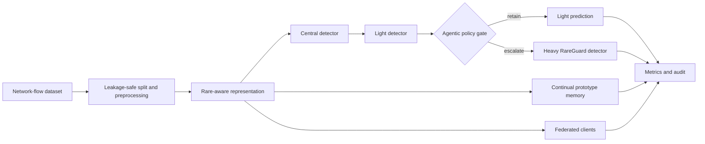

# RareGuard-XIDS

<p align="center">
  <strong>Rare-attack-aware, continual, federated and agentic intrusion detection</strong><br>
  An artifact-backed research implementation with deterministic evaluation, saved execution logs and a public interactive replay console.
</p>

<p align="center">
  <a href="https://deepakvermalab.github.io/RareGuard-XIDS-Simulation/"><strong>Open the interactive simulation</strong></a>
</p>

<p align="center">
  
  
  
  
</p>

> [!IMPORTANT]
> The implementation and notebook execution are complete, but the final evidence audit is **NOT_READY**: 12 of 19 scientific gates pass. This repository preserves negative and mixed findings rather than rewriting results to force superiority.

## Overview

RareGuard-XIDS extends the earlier NOVA-XIDS line of work with four research components:

- rare-attack-aware representation learning;
- prototype-assisted continual adaptation;
- non-IID federated evaluation;
- an agentic light-to-heavy inference policy with validation-selected escalation gates.

The repository includes the full implementation, stage notebooks with saved outputs, final-v2 result tables, execution logs, figures, audit reports and reproducibility metadata. Raw datasets, fitted model binaries and processed tensors are intentionally excluded from Git.

## System architecture



## Verified evidence snapshot

| Evidence item | Verified value |
|---|---:|
| Datasets | 6 |
| Deterministic seeds | 5 |
| Central rows | 132 / 132 |
| Continual rows | 54 / 54 |
| Federated rows | 72 / 72 |
| Agentic policy rows | 90 / 90 |
| Agent validation selections | 30 / 30 |
| Robustness rows | 240 / 240 |
| Recorded agent decisions | 149,030 |
| Scientific readiness gates | 12 / 19 pass |

The exact readiness boundary is stored in [`evidence/reports/PUBLICATION_READINESS.json`](evidence/reports/PUBLICATION_READINESS.json), with the human-readable audit in [`evidence/reports/PUBLICATION_EVIDENCE_AUDIT.md`](evidence/reports/PUBLICATION_EVIDENCE_AUDIT.md).

## Repository layout

```text
.
├── configs/                 # Dataset, experiment and publication protocols
├── docs/                    # Implementation and publication protocol notes
├── evidence/
│   ├── figures/             # Final publication figures
│   ├── logs/                # Saved stage execution logs
│   ├── reports/             # Readiness, provenance and policy reports
│   └── results/             # Final-v2 CSV/JSON result tables
├── notebooks/               # Executed stage notebooks 00–21
├── scripts/                 # Notebook builders, environment and sync utilities
├── src/rareguard/           # Research package
├── tests/                   # Smoke and publication protocol tests
└── deployment/              # Interactive research simulation source
```

## Notebook pipeline

| Stage | Notebooks | Purpose |
|---|---|---|
| Environment and smoke pipeline | `00`–`07` | Environment, discovery, preprocessing, baselines and early pipeline checks |
| Original publication protocol | `08`–`14` | Data, central, continual, federated, agentic, robustness and audit stages |
| Corrective final-v2 protocol | `15`–`21` | External confirmation, corrected tuning, final experiments and evidence audit |

Executed notebooks retain their printed outputs. Machine-readable logs are separately preserved under [`evidence/logs`](evidence/logs).

## Installation

```bash
python3 -m venv .venv
source .venv/bin/activate
python -m pip install --upgrade pip
python -m pip install -r requirements.txt
python -m pip install -e .
```

Run the test suite:

```bash
pytest -q
```

## Dataset boundary

Datasets are not redistributed in this repository. Configure the local or mounted Google Drive dataset root in `configs/datasets.yaml` and `configs/datasets_v2.yaml`. Preprocessing fits transformations on training data only and records split metadata for overlap auditing.

## Evidence and claim policy

- Development, validation, external-confirmation and locked-test roles remain separated.
- Diagnostic replay values are not treated as benchmark results.
- Energy in joules is not claimed because no external power meter was used.
- The study uses bounded deterministic samples rather than full-corpus reproduction.
- Ablations are reported exactly as measured, including cases that outperform the full model.
- A complete execution package does not imply journal acceptance or universal model superiority.

## Interactive research console

The public simulation replays saved light-to-heavy routing decisions and exposes the evidence boundary without requiring the private training repository:

**https://deepakvermalab.github.io/RareGuard-XIDS-Simulation/**

The simulator source is maintained in the public repository [`DeepakVermaLab/RareGuard-XIDS-Simulation`](https://github.com/DeepakVermaLab/RareGuard-XIDS-Simulation).

## Citation

Citation metadata is available in [`CITATION.cff`](CITATION.cff). Update the manuscript title, author identifiers and publication fields after formal acceptance.

## Research status

This is an active research codebase. The final-v2 implementation is complete; seven scientific readiness gates remain unsupported and are explicitly retained in the audit package.
