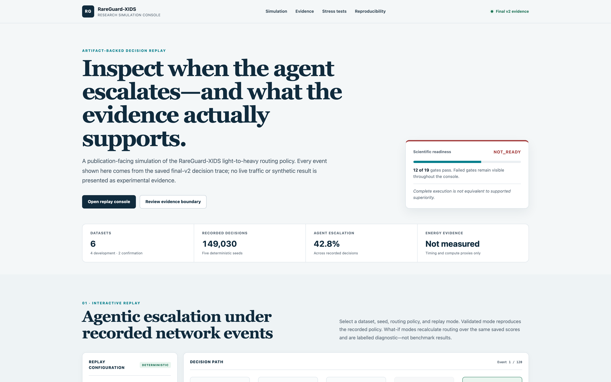

# RareGuard-XIDS Research Simulation

<p align="center">
  <strong>Artifact-backed interactive replay for rare-attack-aware intrusion detection</strong><br>
  Inspect light-to-heavy routing decisions, evidence trade-offs and scientific readiness directly in the browser.
</p>

<p align="center">
  <a href="https://deepakvermalab.github.io/RareGuard-XIDS-Simulation/"><strong>Launch the live simulation</strong></a>
</p>

<p align="center">
  
  
  
</p>



## What the console shows

- deterministic replay of saved agent decisions;
- light-detector, policy-gate and heavy-detector routing;
- validation-selected and explicitly labelled diagnostic threshold modes;
- policy explanations without misrepresenting them as feature attribution;
- central, baseline, robustness, ablation, continual and federated evidence;
- timing and compute proxies with an explicit no-joule-energy boundary;
- readiness gates, source hashes and downloadable audit material.

## Run locally

```bash
python3 -m http.server 4173 --bind 127.0.0.1
```

Open <http://127.0.0.1:4173/>. The evidence bundle is loaded using `fetch`, so opening `index.html` directly is not supported.

## Evidence bundle

The compact browser bundle is stored at `assets/data/evidence.json`. The authoritative source tables used to build it are under `evidence/source`.

Rebuild after replacing any source artifact:

```bash
python3 scripts/build_evidence_bundle.py
```

The builder verifies required files, hashes source artifacts, checks all 149,030 recorded decisions and regenerates the browser bundle.

## Capture paper screenshots

With the local server running:

```bash
node scripts/capture_screenshots.mjs
```

The script writes five `3840×2400` section views and one full-console view to `screenshots/`.

## Deployment

The repository is buildless and includes `.nojekyll`. The included GitHub Actions workflow publishes the repository root to GitHub Pages after each push to `main`.

Live URL: **https://deepakvermalab.github.io/RareGuard-XIDS-Simulation/**

## Scientific boundary

This interface is a replay of recorded, bounded experiment evidence—not live packet inference or a production 24/7 deployment. Final-v2 readiness remains `NOT_READY`: 12 of 19 gates pass. Energy in joules, full-corpus reproduction and universal model superiority are not supported. Diagnostic threshold modes are local replays and must not be cited as new benchmark runs.

## Related repository

The complete private research implementation, executed notebooks and full curated logs are maintained in `DeepakVermaLab/RareGuard-XIDS`.
